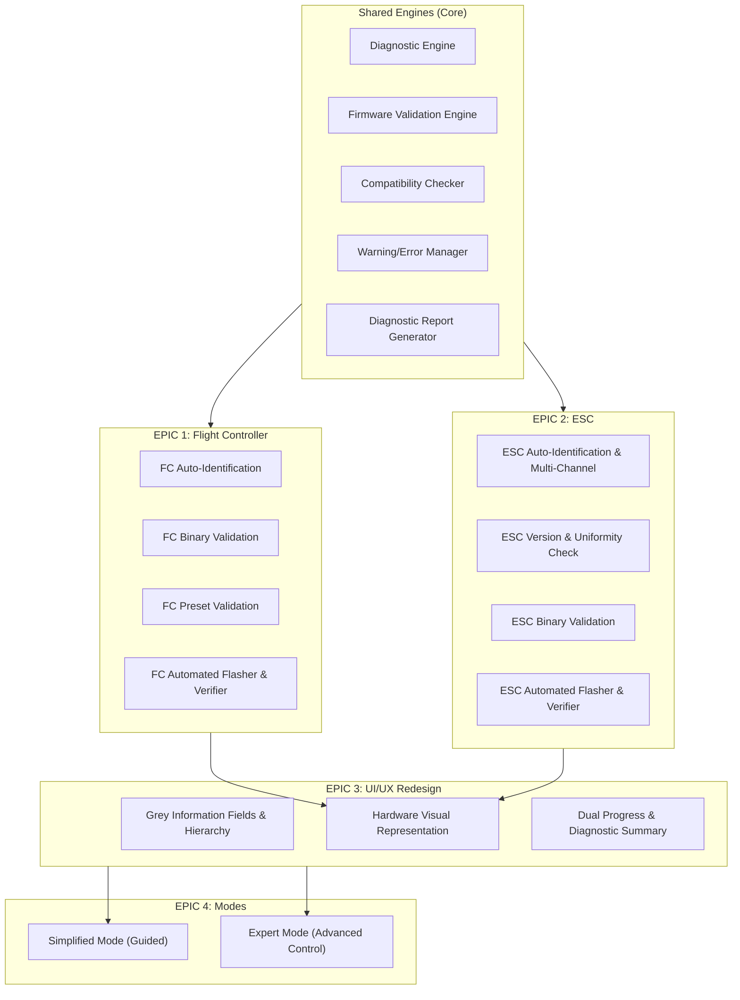

# DEVELOPMENT ROADMAP — Drone Firmware Verification & Flashing Station

**Document Version:** 1.0.0  
**Date:** 2026-11-06  
**Status:** Planning / Ready for Implementation Approval  
**Architecture Baseline:** ES Modules, Web Serial API, Single-Page App (`index5.html`)

---

## 1. Executive Summary & Architecture Strategy

This roadmap details the transformation of the **Drone Setup Station** from a script/preset-oriented tool into a **production-grade drone firmware verification and flashing application**.

### Core Architecture Pillars:
1. **Clean Separation of Concerns:**
   - **Shared Diagnostic & Validation Engine:** Hardware inspection, firmware binary parsing/validation, sanity checking, and structured issue reporting (`ErrorManager`).
   - **Protocol Engines:** Dedicated FC (Betaflight CLI / MSP / DFU) and ESC (MSP 4-Way / BLHeli_32 / AM32) communication modules.
   - **Dual Operation Modes:** **Simplified Mode** (automated zero-friction diagnostics, guarded 1-click workflows, big visual indicators) and **Expert Mode** (deep manual control, RAW hex inspector, arbitrary CLI, manual binary flashing, full logs).
2. **Safety First:** Strict hardware identity validation before any erase or write operation. Never write binary data to an unrecognized target. Pre-flash backups and post-flash verification must remain mandatory.
3. **No Unnecessary Abstractions:** Reuse existing Web Serial lifecycle, CRC-16 XMODEM implementations, 4-Way framing, and pure DOM ES module structure without heavy runtime frameworks.

---

## 2. EPIC Breakdown & Task Catalog



---

### EPIC 1 — Flight Controller (FC)

| Task ID | Task Description | Status | Dependencies | Priority | Relevant Files | Acceptance Criteria |
| :--- | :--- | :--- | :--- | :--- | :--- | :--- |
| **FC-01** | **Automatic FC Target & Hardware Identification** | Partially Implemented | None | P0 | `js/betaflight/cli.js`, `js/betaflight/fc_diag.js` (new) | Upon connecting serial, automatically detect MCU type (`STM32F405`, `F722`, `H7`, etc.), target board name (`SPEDIXF722`, etc.), configuration version, and craft name without requiring user action. |
| **FC-02** | **FC Firmware Version Detection & Comparison** | Partially Implemented | FC-01 | P0 | `js/betaflight/cli.js`, `js/core/diag_engine.js` (new) | Parse running firmware version (e.g., `4.5.1 Dec 2 2024`) from `version`. Compare against `expectedVersion` (preset or user target). Surface an explicit status: `MATCH`, `OUTDATED`, `AHEAD`, or `MISMATCH`. |
| **FC-03** | **Firmware Binary Validation & Sanity Inspection** | Missing | None | P0 | `js/core/firmware_validator.js` (new) | Validate uploaded `.hex` or `.bin` files for FC: check Intel HEX record checksums, detect target board string inside binary headers/descriptors, verify vector table address, and flag completely incorrect or corrupted binaries before flashing. |
| **FC-04** | **FC Preset Compatibility & Board Mismatch Guard** | Implemented (Basic) | FC-01 | P1 | `js/betaflight/preset.js`, `js/core/compat_checker.js` (new) | Compare CLI preset target (`board_name` or `# target:`) against actual board. Prevent flashing if incompatible. Validate resource mappings and syntax markers prior to execution. |
| **FC-05** | **Automatic Execution of Setup Workflow (Steps 1 & 2)** | Partially Implemented | FC-01, ESC-01 | P1 | `js/core/workflow.js` (new), `js/main.js` | One-click or automated chained execution: automatically backup FC config -> flash/verify FC preset -> reboot FC -> automatically transition to ESC initialization without manual button clicks. |
| **FC-06** | **FC Flashing Result Post-Verification** | Partially Implemented | FC-04 | P0 | `js/betaflight/preset.js` | After flashing preset / firmware, query `status` / `diff` from FC to verify critical parameters (board name, motor protocol, PID loop, VTX, serial ports) actually persisted into flash. |
| **FC-07** | **FC Warning and Error Reporting Subsystem** | Partially Implemented | None | P1 | `js/core/error_manager.js` (new), `js/ui/status.js` | Normalize all FC errors (`###ERROR`, `PARSE ERROR`, CLI prompt timeout, serial disconnect during flash) into structured warnings/errors with user-actionable remediation instructions. |

---

### EPIC 2 — Electronic Speed Controller (ESC)

| Task ID | Task Description | Status | Dependencies | Priority | Relevant Files | Acceptance Criteria |
| :--- | :--- | :--- | :--- | :--- | :--- | :--- |
| **ESC-01** | **Automatic ESC Identification & Dynamic Count Detection** | Partially Implemented | None | P0 | `js/blheli/protocol.js`, `js/blheli/esc_diag.js` (new) | Automatically discover number of active ESC channels (dynamically detect 4, 6, or 8 instead of hardcoded 4). Query chip signature (`0x...`) and protocol responsiveness for each channel. |
| **ESC-02** | **ESC Firmware Version Detection & Cross-ESC Comparison** | Missing | ESC-01 | P0 | `js/blheli/esc_diag.js` (new), `js/core/diag_engine.js` (new) | Query and decode bootloader version, MCU model, and firmware version/layout on each ESC. Check uniformity across all ESCs (e.g. alert user if ESC #3 is on v32.7 while ESC #1,2,4 are on v32.9). |
| **ESC-03** | **Expected vs Actual ESC Firmware Validation** | Missing | ESC-02 | P0 | `js/core/compat_checker.js` (new) | Allow defining an expected ESC firmware version/target. Compare actual detected ESC versions and show green check / amber warning / red mismatch. |
| **ESC-04** | **ESC Binary Compatibility & Corrupt Binary Detection** | Missing | None | P0 | `js/core/firmware_validator.js` (new) | Inspect uploaded ESC firmware binary (`.hex` / `.bin`). Verify target architecture (BLHeli_32 ARM / AM32 / BLHeli_S), flash memory layout limits, and prevent flashing a quad with an incompatible motor layout binary. |
| **ESC-05** | **Automated Multi-ESC Flashing Engine** | Partially Implemented (EEPROM Patch only) | ESC-01, ESC-04 | P1 | `js/blheli/flasher.js` (new), `js/blheli/protocol.js` | Provide safe flashing workflow across all detected ESCs: sequential connect -> erase/write flash blocks -> ACK checks with retry budget -> auto-reboot to bootloader. |
| **ESC-06** | **Post-Flash ESC Verification & Health Check** | Partially Implemented (Restore verify exists) | ESC-05 | P0 | `js/blheli/flasher.js` (new), `js/blheli/protocol.js` | Read back flashed blocks from ESC flash/EEPROM, compute CRC16/SHA256, verify 100% byte match against target binary, and perform live `TestAlive` connection check. |
| **ESC-07** | **Per-ESC Operation Logging & Audit Trail** | Partially Implemented (Global log only) | None | P1 | `js/core/logger.js` (new), `js/ui/esc_card.js` (new) | Maintain independent log streams or tagged log entries for each ESC (ESC 1, 2, 3, 4) tracking read attempts, write progress, CRC errors, and retry counts. |

---

### EPIC 3 — UI/UX Redesign

| Task ID | Task Description | Status | Dependencies | Priority | Relevant Files | Acceptance Criteria |
| :--- | :--- | :--- | :--- | :--- | :--- | :--- |
| **UI-01** | **Grey Informational Fields & Clear Visual Hierarchy** | Missing | None | P1 | `css/components.css`, `css/main.css` | Introduce clean, low-contrast grey informational panels (`--info-bg: #1c2027`, neutral borders) for passive diagnostic readouts to clearly distinguish them from actionable buttons and critical alerts. |
| **UI-02** | **Enhanced Typography & High-Legibility Readouts** | Missing | None | P1 | `css/main.css`, `css/typography.css` (new) | Increase font scale for hardware parameters, board names, version numbers, and statuses (16px–24px bold) with high contrast so users can read diagnostic info from a bench distance. |
| **UI-03** | **Comprehensive Status Indicators & Visual States** | Partially Implemented | None | P1 | `css/components.css`, `js/ui/status.js` | Standardize visual indicators across both FC and ESC: `Idle/Disconnected` (Grey), `Analyzing/Working` (Pulsing Blue/Amber), `Healthy/Matched` (Green), `Warning/Notice` (Amber), `Error/Failure` (Red). |
| **UI-04** | **FC and ESC Visual Physical Representation** | Missing | FC-01, ESC-01 | P2 | `js/ui/drone_visualizer.js` (new), `css/components.css` | Interactive 2D schematic of a quadcopter showing FC at center and ESCs at the 4 motor arms with motor rotation directions (Normal CW vs Reversed CCW) and real-time status badges. |
| **UI-05** | **Expected vs Actual Firmware Comparison Table** | Missing | FC-02, ESC-02 | P1 | `js/ui/diag_view.js` (new), `index5.html` | Side-by-side or tabular comparison showing component (FC, ESC 1-4), Detected Firmware, Expected Firmware, Target Board, and Compatibility Badge. |
| **UI-06** | **Dual Flashing Progress Indicators** | Partially Implemented (Single modal/log) | None | P1 | `js/ui/progress.js` (new), `css/components.css` | Dedicated visual progress bars showing both overall workflow progress (e.g. Step 3 of 6) and granular byte/block transfer progress (0%–100% with KB/s transfer rate). |
| **UI-07** | **Consolidated Diagnostic Summary Panel** | Missing | SE-01, SE-05 | P1 | `js/ui/diag_summary.js` (new) | A unified card summarizing all pre-flight hardware checks: FC target match, FC firmware version, ESC count, ESC firmware uniformity, LiPo voltage presence, and preset validity. |
| **UI-08** | **Session Operation History & Export** | Missing | SE-04, SE-05 | P2 | `js/core/logger.js`, `js/ui/history.js` (new) | Session drawer or modal showing all operations performed during the session (connect, backup, flash, verify) with timestamps and the ability to export the full diagnostic log as `.json` or `.txt`. |

---

### EPIC 4 — Simplified Mode vs Expert Mode

| Task ID | Task Description | Status | Dependencies | Priority | Relevant Files | Acceptance Criteria |
| :--- | :--- | :--- | :--- | :--- | :--- | :--- |
| **MODE-01**| **Application Mode Switcher (Simplified / Expert)** | Missing | None | P0 | `js/core/mode_manager.js` (new), `index5.html`, `css/main.css` | Persistent toggle in the header between "Simplified Mode" and "Expert Mode" (stored in `localStorage`). Smoothly toggles UI element visibility and workflow rules without reloading the page. |
| **MODE-02**| **Simplified Mode: Zero-Config Guided Workflow** | Missing | MODE-01, SE-01, FC-05 | P0 | `js/modes/simplified.js` (new), `index5.html` | In Simplified Mode: hide raw CLI textarea, hide hex dumps, hide manual EEPROM address controls. Provide a large "Start Auto-Verification & Flash" button that runs diagnostics -> prompts confirmation -> flashes -> shows final pass/fail report. |
| **MODE-03**| **Expert Mode: Full Control & Deep Diagnostics** | Partially Implemented (Current baseline) | MODE-01 | P0 | `js/modes/expert.js` (new), `index5.html` | In Expert Mode: preserve and expose all raw CLI input/output, manual port selection, diff/dump selectors, per-ESC manual read/backup/restore, binary patch inspection, and raw serial logs. |
| **MODE-04**| **Automated Diagnostic & Pre-Check Pipeline for Simplified Mode**| Missing | MODE-02, SE-01, SE-03 | P1 | `js/core/diag_engine.js` | Automated checklist executed before enabling the flash button: USB connection verified -> FC target verified -> LiPo detected (ESC responds) -> all 4 ESCs operational -> binaries verified. |
| **MODE-05**| **Comprehensive Diagnostic Report Generator** | Missing | SE-05, MODE-02 | P1 | `js/core/report_generator.js` (new), `js/ui/modal.js` | At completion of Simplified or Expert workflows, generate a clean summary modal or downloadable HTML/JSON report documenting FC version, ESC versions, applied preset, and verification status. |

---

## 3. Shared Architectural Components (Core Engine)

To prevent duplication and avoid unnecessary abstractions, the following shared modules will serve both FC and ESC:

```
js/
├── core/
│   ├── serial.js              (Existing: Web Serial port management & lifecycle)
│   ├── state.js               (Existing: Central application state)
│   ├── mode_manager.js        (New: Simplified vs Expert mode state & UI visibility)
│   ├── diag_engine.js         (New: Hardware inspection & status aggregation)
│   ├── firmware_validator.js  (New: Intel HEX & raw binary parser / checksum validator)
│   ├── compat_checker.js      (New: Target name, version diff & hardware matching)
│   ├── error_manager.js       (New: Unified error code mapping & user alerts)
│   ├── logger.js              (New: Tagged multi-stream logging & history)
│   └── report_generator.js    (New: Diagnostic report builder)
├── betaflight/
│   ├── cli.js                 (Existing: CLI communication)
│   ├── preset.js              (Existing: Preset flashing)
│   ├── backup.js              (Existing: FC configuration backup)
│   └── fc_diag.js             (New: FC-specific diagnostic extraction)
├── blheli/
│   ├── protocol.js            (Existing: 4-Way low-level frames & MSP)
│   ├── eeprom.js              (Extracting in Phase 8: read/write blocks)
│   ├── backup.js              (Extracting in Phase 8: JSON backup/restore)
│   ├── preset.js              (Extracting in Phase 8: preset patching)
│   └── esc_diag.js            (New: Multi-ESC discovery & version parsing)
├── ui/
│   ├── log.js                 (Existing: Terminal console)
│   ├── status.js              (Existing: Badges & status helpers)
│   ├── modal.js               (Existing: Popup notifications)
│   ├── drone_visualizer.js    (New: 2D Drone & ESC schematic)
│   ├── progress.js            (New: Dual progress bars)
│   └── diag_view.js           (New: Side-by-side expected vs actual comparison table)
└── utils/
    ├── bytes.js               (Existing: byte serialization & delay)
    └── crc.js                 (Existing: CRC16-XMODEM)
```

---

## 4. Phased Implementation Order

```
[Phase 8: Extract BLHeli Modules & Clean index5.html] (Immediate Architecture Prerequisite)
       │
       ▼
[Phase 9: Shared Validation & Diagnostic Engine (Core)]
  ├── ErrorManager (js/core/error_manager.js)
  ├── FirmwareValidator (js/core/firmware_validator.js)
  └── CompatChecker (js/core/compat_checker.js)
       │
       ▼
[Phase 10: Automatic Hardware Diagnostics (FC + ESC)]
  ├── FC Diag: automatic board, target & firmware parser (fc_diag.js)
  └── ESC Diag: dynamic channel detection, version uniformity check (esc_diag.js)
       │
       ▼
[Phase 11: UI/UX Redesign & Diagnostic Presentation]
  ├── Grey info fields, typography hierarchy & status indicator system
  ├── 2D Drone/ESC visual representation
  └── Expected vs Actual side-by-side table & dual progress bars
       │
       ▼
[Phase 12: Dual Mode System (Simplified vs Expert) & Report Generator]
  ├── ModeManager (Simplified / Expert toggle)
  ├── Guided 1-click workflow with automated pre-checks
  └── Diagnostic Report Generator (summary & export)
```
