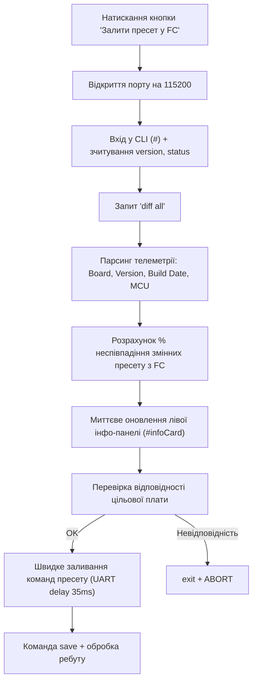

# PROJECT_MAP: `index5.html`

> **Drone Setup Station: Betaflight & BLHeli_32 Configurator**  
> Односторінковий веб-додаток (Single-Page HTML Application) на базі **Web Serial API** для прошивки пресетів польотного контролера (Betaflight CLI), моніторингу телеметрії та % неспівпадіння зі стеком, а також конфігурації/резервного копіювання регуляторів обертів (BLHeli_32 через MSP 4-Way Passthrough).

---

## 1. Загальна структура інтерфейсу (`index5.html`)

| Розділ | Елементи / Селектори | Опис |
| :--- | :--- | :--- |
| **Панель вибору COM-порту** | `.top-bar`, `#portSelect`, `#boardTargetBadge` | Верхній бар вибору Web Serial пристрою та індикатор цільової плати (`Target: SPEDIXF722`). |
| **Ліва інфо-панель (Sidebar)** | `.sidebar-col`, `.info-card` | Інформація про польотник (`#infoBoardName`, `#infoFirmwareVer`, `#infoBuildDate`, `#infoMcuType`) та бейдж неспівпадіння (`#infoMismatchBadge`, `#infoMismatchNote`). |
| **Крок 1: Заливання пресету FC** | `#cardStep1`, `#presetInput`, `#btnFlashFC`, `#btnBackup`, `#btnSkipToEsc` | Картка Betaflight CLI Flasher для аналізу поточної конфігурації, розрахунку % неспівпадіння та запису команд. |
| **Крок 2: Настройка BLHeli_32** | `#cardStep2`, `#badgeEsc0`..`#badgeEsc3`, `#btnReadESC`, `#btnConfigureESC` | Статуси 4-х ESC, читання налаштувань, бекап, відновлення та бінарне застосування пресету. |
| **Панель логування (Console)** | `.log-panel`, `#log` | Консоль реального часу для деталізованого виводу операцій із портом. |
| **Модальне вікно статусу** | `#statusModal`, `#modalBox` | Спливаюче вікно для нотифікацій про хід операцій або помилки. |

---

## 2. DOM-елементи та UI-компоненти

### Управління COM-портом та індикація
* `#portSelect` — випадаючий список доступних Web Serial портів + опція `+ Обрати / Додати новий порт...`.
* `#boardTargetBadge` — бейдж цільової плати (`Target: SPEDIXF722`).
* `#stepStatus1`, `#stepStatus2` — індикатори статусу виконання Кроків 1 та 2 (`awaiting`, `working`, `success`, `fail`).
* `#badgeEsc0`, `#badgeEsc1`, `#badgeEsc2`, `#badgeEsc3` — індивідуальні статуси для ESC #1..#4 (`pending`, `working`, `ok`, `fail`).
* `#log` — контейнер термінального логу.
* `#statusModal`, `#modalBox`, `#modalTitle`, `#modalMsg`, `#modalCloseBtn` — елементи модального вікна.

### Ліва інфо-панель польотника (FC Info & Preset Mismatch)
* `#infoBoardName` — назва плати / target польотного контролера.
* `#infoFirmwareVer` — версія прошивки Betaflight (наприклад, `4.5.1`).
* `#infoBuildDate` — дата та час збірки прошивки.
* `#infoMcuType` — архітектура/модель MCU (наприклад, `STM32F7X2`).
* `#infoMismatchBadge` — відсоток неспівпадіння конфігурації стеку з пресетом (`match-exact`, `match-low-diff`, `match-high-diff`).
* `#infoMismatchNote` — лічильник неспівпалих змінних (`X із Y змінних відрізняються`).

### Кнопки та інпути Кроку 1 (Betaflight FC)
* `#presetInput` — `<textarea>` з командами CLI (`defaults nosave`, `batch start`, ресурси, мікси, OSD, VTX, профілі PID/Rate).
* `#btnFlashFC` — **«Залити пресет у FC»** (вхід у CLI, зчитування телеметрії, розрахунок % неспівпадіння через `diff all` та швидкий запис пресету).
* `#backupType` — `<select>` вибору типу бекапу (`diff all` або `dump all`).
* `#btnBackup` — **«💾 Зберегти бекап»** (експорт налаштувань FC у файл).
* `#btnSkipToEsc` — **«Перейти до ESC ➜»** (пропуск Кроку 1 з записом у лог).

### Кнопки та інпути Кроку 2 (BLHeli_32 ESC)
* `#btnReadESC` — **«🔍 Зчитати поточні налаштування ESC»** (читання 256 байт RAW EEPROM `0xF800` з кожного ESC у лог).
* `#btnBackupESC` — **«💾 Копія всіх 4 ESC»** (експорт RAW дампу всіх 4 ESC у `.json`).
* `#btnRestoreESC` + `#fileRestoreESC` — **«♻️ Відновити з файлу»** (відновлення конфігурації ESC із `.json`).
* `#btnConfigureESC` — **«⚡ Застосувати пресет до 4 ESC»** (безпечна бінарна заміна блоків `0x00..0x07` та `0x10..0x1F`).

---

## 3. Модульна JavaScript-архітектура

### 3.1. Ядро та утиліти
* **`js/core/state.js`**: єдине джерело стану (`port`, `availablePorts`, `popupTimer`, `ignoreRebootEventsUntil`).
* **`js/core/serial.js`**: життєвий цикл Web Serial, безпечне відкриття/закриття дескрипторів потоків `closeSerialSession`, обробники `connect`/`disconnect`.
* **`js/ui/log.js`**: вивід у консоль DOM з автоскролом.
* **`js/ui/status.js`**: оновлення статусних бейджів кроків та ESC.
* **`js/ui/infoPanel.js`**: рендеринг телеметрії FC та стану неспівпадіння (`updateInfoPanel`, `resetInfoPanel`).
* **`js/ui/modal.js`**: модальні повідомлення успіху/помилки.
* **`js/utils/bytes.js`**: утиліти роботи з масивами байтів, hex-конвертери, завантаження файлів.
* **`js/utils/crc.js`**: апаратні контрольні суми `CRC-16/CCITT (XMODEM)`.

### 3.2. Модуль Betaflight (`js/betaflight/`)
* **`cli.js`**: потокове читання `readCliResponse` з контролем промпту `#` та таймаутів; визначення імені плати `parseBoardName`.
* **`info.js`**:
  * `parseFcDetails(versionText, statusText)`: витяг плати, версії прошивки, дати/часу збірки та типу MCU.
  * `extractConfigVariables(text)`: витяг параметрів конфігурації `set param = value`.
  * `calculateMismatch(presetText, fcDiffText)`: порівняння параметрів, заданих у пресеті, з повною конфігурацією FC (`diff all`), підрахунок відсотка (%) неспівпадіння.
* **`preset.js`**:
  * `flashBetaflightPreset()`: повний конвеєр прошивки з дотриманням правила **безпеки (нуль звернень до порту до натискання на кнопку)**.
  * Зчитує `version`, `status` та `diff all`, миттєво відображає дані в інфо-панелі та логах.
  * Виконує високошвидкісну построкову передачу команд з контролем помилок.
* **`backup.js`**: експорт поточної конфігурації FC у файл (`diff all` / `dump all`).

### 3.3. Модуль BLHeli_32 (`js/blheli/`)
* **`protocol.js`**: низькорівнева реалізація MSPv1 та 4-Way протоколу (команди `0x30..0x3F`, адресація `0xF800`, підключення та опитування ESC).
* У `index5.html` наразі збережено високорівневі методи читання блоків, автобекапу та застосування Dummy Patch до регуляторів.

---

## 4. Схема потоку даних аналізу та прошивки

---

## 5. Деплой та інфраструктура проєкту

* **Точка входу:** `index5.html` налаштована як головний документ у `netlify.toml` (SPA rewrite `/ -> /index5.html 200!`).
* **CI/CD:** Автоматичний деплой на Netlify при оновленні гілок через GitHub Actions.
