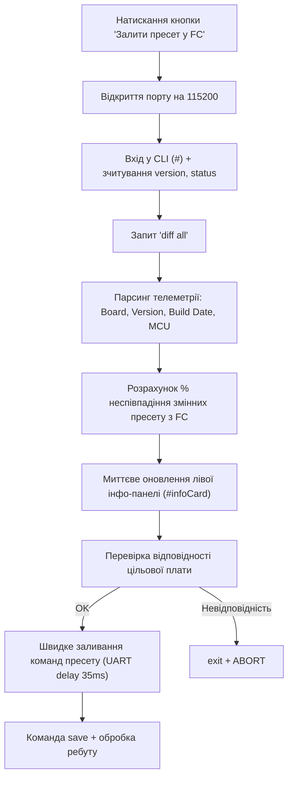

# PROJECT_MAP: `index5.html`

> **Drone Setup Station: Betaflight & BLHeli_32 Configurator**  
> Односторінковий веб-додаток (Single-Page HTML Application) на базі **Web Serial API** для прошивки пресетів польотного контролера (Betaflight CLI), моніторингу телеметрії та % неспівпадіння зі стеком, а також конфігурації/резервного копіювання регуляторів обертів (BLHeli_32 через MSP 4-Way Passthrough).

---

## 1. Загальна структура інтерфейсу (`index5.html`)

| Розділ | Елементи / Селектори | Опис |
| :--- | :--- | :--- |
| **Панель вибору COM-порту** | `.top-bar`, `#portSelect`, `#btnToggleMode`, `#boardTargetBadge` | Верхній бар вибору Web Serial пристрою, перемикач режимів (Спрощений ⇄ Експертний) та індикатор цільової плати. |
| **Ліва інфо-панель (Sidebar)** | `.sidebar-col`, `.info-card`, `#infoCardEsc` | Розділена на два блоки: **Крок 1** (параметри FC: `#infoBoardName`, `#infoFirmwareVer`, `#infoBuildDate`, `#infoMcuType`, `#infoDeviceId`, бейдж неспівпадіння `#infoMismatchBadge`, `#infoMismatchNote`) та **Крок 2** (телеметрія ESC/моторів: `#infoEscModel`, `#infoEscMcu`, `#infoEscPowerAck`, `#infoEscDirs`, `#infoEscPresetStatus`). |
| **Крок 1: Заливання пресету FC** | `#cardStep1`, `#fcFlashProgress`, `#subStepFlash`, `#subStepReadDiff`, `#subStepVerify`, `#btnRunSimplified`, `#presetInput`, `#btnFlashFC`, `#btnBackup`, `#btnSkipToEsc` | Мастер-кнопка для спрощеного режиму, робочі кнопки, textarea пресету та 3-етапний індикатор виконання (прошивка, читання, перевірка). |
| **Крок 2: Настройка BLHeli_32** | `#cardStep2`, `#escFlowPipeline`, `#escFlowConnect`..`#escFlowClose`, `#badgeEsc0`..`#badgeEsc3`, `#btnConnectESC`, `#btnDisconnectESC`, `#btnReadESC`, `#btnConfigureESC`, `#btnBackupESC`, `#btnRestoreESC`, `#fileRestoreESC` | 5-етапний конвеєр налаштування ESC (Підключення ➔ Заливка ➔ Перевірка ➔ Статус OK ➔ Закриття), кнопки сесії, статуси 4-х ESC, читання, бекап, відновлення та застосування пресету. |
| **Панель логування (Console)** | `.log-panel`, `#log` | Консоль реального часу (прихована у спрощеному режимі). |
| **Права колонка (Спрощений режим)** | `.right-col`, `#simplifiedRightCol`, `#progBanner`, `#progStep1`..`#progStep4`, `#statDailySuccess`, `#statAllSuccess`, `.faq-card` | Панель прогресу (таймлайн 4 кроків), статистика прошитих пристроїв за унікальним ID (сьогодні та за весь час) та FAQ. |
| **Модальне вікно статусу** | `#statusModal`, `#modalBox` | Спливаюче вікно для нотифікацій про хід операцій або помилки. |
| **Точка завантаження скриптів** | `` | Повністю винесений JS код, нуль інлайн-скриптів у HTML. |

---

## 2. DOM-елементи та UI-компоненти

### Управління COM-портом та індикація
* `#portSelect` — випадаючий список доступних Web Serial портів + опція `+ Обрати / Додати новий порт...`.
* `#boardTargetBadge` — бейдж цільової плати (`Target: SPEDIXF722`).
* `#stepStatus1`, `#stepStatus2` — індикатори статусу виконання Кроків 1 та 2 (`awaiting`, `working`, `success`, `fail`).
* `#escFlowPipeline` — 5-етапна візуальна лінія прогресу налаштування регуляторів:
  * `#escFlowConnect` — 1. Підключення
  * `#escFlowFlash` — 2. Заливка
  * `#escFlowVerify` — 3. Перевірка
  * `#escFlowStatus` — 4. Статус OK
  * `#escFlowClose` — 5. Закриття
* `#badgeEsc0`, `#badgeEsc1`, `#badgeEsc2`, `#badgeEsc3` — індивідуальні статуси для ESC #1..#4 (`pending`, `working`, `ok`, `fail`).
* `#log` — контейнер термінального логу.
* `#statusModal`, `#modalBox`, `#modalTitle`, `#modalMsg`, `#modalCloseBtn` — елементи модального вікна.

### Ліва інфо-панель польотника та ESC (FC & ESC Info Panel)
* `#infoBoardName` — назва плати / target польотного контролера.
* `#infoFirmwareVer` — версія прошивки Betaflight (наприклад, `4.5.1`).
* `#infoBuildDate` — дата та час збірки прошивки.
* `#infoMcuType` — архітектура/модель MCU (наприклад, `STM32F7X2`).
* `#infoMismatchBadge` — відсоток неспівпадіння конфігурації стеку з пресетом (`match-exact`, `match-low-diff`, `match-high-diff`).
* `#infoMismatchNote` — лічильник неспівпалих змінних (`X із Y змінних відрізняються`).
* `#infoEscModel` — відкрита текстова назва моделі ESC та версія прошивки (ASCII з блоку).
* `#infoEscMcu` — апаратна модель процесора ESC на базі сигнатури (наприклад, `STM32G071 (0x0460)`).
* `#infoEscPowerAck` — апаратний статус зв'язку та живлення регуляторів (`OK (4/4 LiPo є)` / `Частково` / `Fail`).
* `#infoEscDirs` — помоторний напрямок обертання та стан пресету (`#1:N(100%) #2:R(100%) ...`).
* `#infoEscPresetStatus` — загальний індикатор відповідності 4-х моторів пресету 100%.

### Кнопки та інпути Кроку 1 (Betaflight FC)
* `#presetInput` — `<textarea>` з командами CLI (`defaults nosave`, `batch start`, ресурси, мікси, OSD, VTX, профілі PID/Rate).
* `#btnFlashFC` — **«Залити пресет у FC»** (вхід у CLI, зчитування телеметрії, розрахунок % неспівпадіння через `diff all` та швидкий запис пресету).
* `#backupType` — `<select>` вибору типу бекапу (`diff all` або `dump all`).
* `#btnBackup` — **«💾 Зберегти бекап»** (експорт налаштувань FC у файл).
* `#btnSkipToEsc` — **«Перейти до ESC ➜»** (пропуск Кроку 1 з записом у лог).

### Кнопки та інпути Кроку 2 (BLHeli_32 ESC)
* `#btnConnectESC` — **«🔗 З'єднатися з ESC»** (ініціалізація та утримання постійної 4-Way сесії).
* `#btnDisconnectESC` — **«❌ Від'єднатися від ESC»** (безпечний вихід `0x34` та закриття порту).
* `#btnReadESC` — **«🔍 Зчитати поточні налаштування ESC»** (читання 256 байт RAW EEPROM `0xF800` з кожного ESC у лог).
* `#btnBackupESC` — **«💾 Копія всіх 4 ESC»** (експорт RAW дампу всіх 4 ESC у `.json`).
* `#btnRestoreESC` + `#fileRestoreESC` — **«♻️ Відновити з файлу»** (відновлення конфігурації ESC із `.json`).
* `#btnConfigureESC` — **«⚡ Застосувати пресет до 4 ESC»** (миттєвий старт в один клік без модальних діалогів, безпечна бінарна заміна блоків `0x00..0x07` та `0x10..0x1F` з автоматичним оновленням лівої інфо-панелі до та після запису).

---

## 3. Модульна JavaScript-архітектура

### 3.1. Точка входу
* **`js/main.js`**: центральна точка ініціалізації додатку. Підключає обробники Web Serial, призначає прослуховувачі подій DOM (`click`, `change`) для всіх кнопок Кроку 1, Кроку 2 та модального вікна.

### 3.2. Ядро та утиліти
* **`js/core/state.js`**: єдине джерело стану (`port`, `availablePorts`, `popupTimer`, `ignoreRebootEventsUntil`, `lastFcDetails`, `escSession`).
* **`js/core/serial.js`**: життєвий цикл Web Serial, безпечне відкриття/закриття дескрипторів потоків `closeSerialSession`, динамічне оновлення портів `resolveSelectedPort`, обробники `connect`/`disconnect` зі скиданням сесії.
* **`js/core/pipeline.js`**: оркестратор автоматичного конвеєра (`runFullDroneSequence`) — Крок 1 FC ➔ очікування ребуту ➔ Крок 2 ESC з перевіркою LiPo та записом статистики за UID.
* **`js/ui/log.js`**: вивід у консоль DOM з автоскролом.
* **`js/ui/status.js`**: оновлення статусних бейджів кроків та ESC, контролер 5-етапного ланцюжка налаштування регуляторів (`setEscFlowStep`, `resetEscFlowPipeline`, `setEscSessionConnected`).
* **`js/ui/infoPanel.js`**: рендеринг телеметрії FC, апаратного UID (`#infoDeviceId`), стану неспівпадіння пресету та телеметрії моторів BLHeli_32 (`updateInfoPanel`, `updateEscInfoPanel`, `resetInfoPanel`).
* **`js/ui/progression.js`**: керування правою панеллю прогресу (`setProgressionStep`, `setProgressionBanner`, `setOverallProgressionBadge`, `resetProgression`).
* **`js/ui/modal.js`**: модальні повідомлення успіху/помилки (`showPopup`, `closeModal`).
* **`js/utils/bytes.js`**: утиліти роботи з масивами байтів, hex-конвертери, завантаження файлів.
* **`js/utils/crc.js`**: апаратні контрольні суми `CRC-16/CCITT (XMODEM)`.
* **`js/utils/stats.js`**: менеджер статистики прошитих пристроїв за унікальним ID (`getStats`, `recordDeviceResult`, `resetDailyStats`, `renderStatsWidget`).

### 3.3. Модуль Betaflight (`js/betaflight/`)
* **`cli.js`**: потокове читання `readCliResponse` з контролем промпту `#` та таймаутів; визначення імені плати `parseBoardName`.
* **`info.js`**:
  * `parseFcDetails(versionText, statusText)`: витяг плати, версії прошивки, дати/часу збірки та типу MCU.
  * `extractConfigVariables(text)`: витяг параметрів конфігурації `set param = value`.
  * `calculateMismatch(presetText, fcDiffText)`: порівняння параметрів, заданих у пресеті, з повною конфігурацією FC (`diff all`), підрахунок відсотка (%) неспівпадіння.
* **`preset.js`**:
  * `flashBetaflightPreset()`: повний конвеєр прошивки з дотриманням правила **безпеки (нуль звернень до порту до натискання на кнопку)**.
  * Автоматично закриває активну 4-Way сесію ESC перед входом у CLI.
  * Зчитує `version`, `status` та `diff all`, миттєво відображає дані в інфо-панелі та логах.
  * Виконує високошвидкісну построкову передачу команд з контролем помилок.
* **`backup.js`**: експорт поточної конфігурації FC у файл (`diff all` / `dump all`).

### 3.4. Модуль BLHeli_32 (`js/blheli/`)
* **`session.js`**:
  * Керування постійною 4-Way сесією (`connectEscSession`, `disconnectEscSession`, `isEscSessionActive`).
  * Дозволяє багаторазове читання/запис без повторного відкриття та закриття порту.
* **`protocol.js`**:
  * Низькорівнева реалізація MSPv1 та 4-Way протоколу (команди `0x30..0x3F`, адресація `0xF800`, підключення та опитування ESC).
  * Еталонний 8-байтний фрейм `CMD_INTERFACE_EXIT` (0x34) з параметром `[0]` (`ParamLen = 1`) для гарантованого переходу FC з 4-Way назад у штатний режим без зависання буфера.
  * Розумна перевірка `CMD_PROTOCOL_GET_VERSION` перед відправкою `MSP 245`.
* **`eeprom.js`**: обгортка сесії 4-Way (`withEscSession`), надійне зчитування 256 байтів з перевіркою CRC-16 та повторами (`readEscBlock`), повне читання налаштувань 4 ESC (`readAllEscSettings`).
* **`preset.js`**: визначення напрямку мотора (`detectMotorDirection`), бінарні константи та застосування 100% пресету із збереженням калібрувальних байтів та контрольною перевіркою (`applyEscPreset`).
* **`backup.js`**: створення резервної копії 4 ESC (`backupAllEscs`), валідація формату дампу (`parseEscBackup`), безпечне двоетапне відновлення з автоматичним бекапом перед записом (`handleRestoreFileChange`).

---

## 4. Схема потоку даних аналізу та прошивки

---

## 5. Деплой та інфраструктура проєкту

* **Точка входу:** `index5.html` налаштована як головний документ у `netlify.toml` (SPA rewrite `/ -> /index5.html 200!`).
* **CI/CD:** Автоматичний деплой на Netlify при оновленні гілок через GitHub Actions.
