# PROJECT_MAP: `index5.html`

> **Drone Setup Station: Betaflight & BLHeli_32 Configurator**  
> Односторінковий веб-додаток (Single-Page HTML Application) на базі **Web Serial API** для прошивки пресетів польотного контролера (Betaflight CLI) та конфігурації/резервного копіювання регуляторів обертів (BLHeli_32 через MSP 4-Way Passthrough).

---

## 1. Загальна структура файлу (`index5.html`)

Файл складається з **1892 рядків** та містить вбудовані стилі (CSS), розмітку (HTML) та логіку (JavaScript):

| Розділ | Рядки | Опис |
| :--- | :--- | :--- |
| **HTML `<head>` та CSS `<style>`** | `1–329` | Темна тема (CSS змінні `--bg`, `--card-bg`, `--primary`, `--secondary`, `--success`, `--error`), стилі карток кроків, бейджів ESC, панелі логування та модального вікна. |
| **Панель вибору USB COM-порту** | `334–343` | Верхній бар вибору пристрою (`#portSelect`) та індикатор цільової плати (`#boardTargetBadge`, за замовчуванням `Target: SPEDIXF722`). |
| **Крок 1: Заливання пресету Betaflight** | `345–575` | Картка `#cardStep1` з текстовим полем `#presetInput` (містить дефолтний CLI пресет для `SPEDIXF722` / `T-System 13`) та кнопками управління FC. |
| **Крок 2: Настройка BLHeli_32 (4-Way)** | `577–620` | Картка `#cardStep2` з описом бінарного патчу, індикаторами стану 4-х ESC (`#badgeEsc0`..`#badgeEsc3`) та кнопками читання/бекапу/відновлення/запису ESC. |
| **Панель логування (Serial Console)** | `622–632` | Консоль реального часу (`#log`) для виводу всіх операцій з COM-портом. |
| **Модальне вікно статусу** | `634–641` | Спливаюче вікно (`#statusModal`) для сповіщень про успіх або помилку. |
| **JavaScript (`<script>`)** | `643–1889` | Уся клієнтська логіка роботи з Web Serial API, Betaflight CLI та протоколом BLHeli_32 4-Way. |

---

## 2. DOM-елементи та UI-компоненти

### Керування COM-портом та індикація
* `#portSelect` — випадаючий список доступних Web Serial портів + опція `+ Обрати / Додати новий порт...`.
* `#boardTargetBadge` — бейдж цільової плати (`Target: SPEDIXF722`).
* `#stepStatus1`, `#stepStatus2` — індикатори статусу виконання Кроків 1 та 2 (`awaiting`, `working`, `success`, `fail`).
* `#badgeEsc0`, `#badgeEsc1`, `#badgeEsc2`, `#badgeEsc3` — індивідуальні статуси для ESC #1..#4 (`pending`, `working`, `ok`, `fail`).
* `#log` — контейнер термінального логу.
* `#statusModal`, `#modalBox`, `#modalTitle`, `#modalMsg`, `#modalCloseBtn` — елементи модального вікна.

### Кнопки та інпути Кроку 1 (Betaflight FC)
* `#presetInput` — `<textarea>` з командами CLI (`defaults nosave`, `batch start`, ресурси, мікси, OSD, VTX, профілі PID/Rate).
* `#btnFlashFC` — **«Залити пресет у FC»** (запис пресету з перевіркою плати та контролем помилок).
* `#backupType` — `<select>` вибору типу бекапу (`diff all` або `dump all`).
* `#btnBackup` — **«💾 Зберегти бекап»** (експорт налаштувань FC у файл).
* `#btnSkipToEsc` — **«Перейти до ESC ➜»** (пропуск Кроку 1 з записом у лог).

### Кнопки та інпути Кроку 2 (BLHeli_32 ESC)
* `#btnReadESC` — **«🔍 Зчитати поточні налаштування ESC»** (читання 256 байт RAW EEPROM `0xF800` з кожного ESC у лог).
* `#btnBackupESC` — **«💾 Копія всіх 4 ESC»** (експорт RAW дампу всіх 4 ESC у `.json`).
* `#btnRestoreESC` + `#fileRestoreESC` — **«♻️ Відновити з файлу»** (відновлення конфігурації ESC із `.json` з попереднім автобекапом та верифікацією).
* `#btnConfigureESC` — **«⚡ Застосувати пресет до 4 ESC»** (безпечна бінарна заміна блоків `0x00..0x07` та `0x10..0x1F`).

---

## 3. Карта JavaScript-архітектури

### 3.1. Глобальний стан та UI-утиліти (`644–828`)
| Символ / Функція | Рядки | Призначення |
| :--- | :--- | :--- |
| `port`, `availablePorts`, `popupTimer`, `ignoreRebootEventsUntil` | `644–647` | Глобальні змінні стану активного COM-порту, таймера попапу та захисту від подій перезавантаження FC. |
| `delay(ms)` | `661` | Проміс-пауза (`setTimeout`). |
| `log(msg)` | `663–666` | Додає рядок у `#log` з автопрокруткою вниз. |
| `setStepStatus(stepNumber, state)` | `668–681` | Оновлює вигляд і текст бейджа `#stepStatus1` або `#stepStatus2`. |
| `resetAllStepStatuses()` | `683–689` | Скидає статуси обох кроків та всіх 4 ESC у початковий стан при підключенні/відключенні USB. |
| `showPopup(type, title, message, autoCloseMs, callback)` | `691–716` | Відображає модальне вікно (`success` з автозакриттям або `error` з кнопкою закриття). |
| `closeModal()` | `718–724` | Закриває модальне вікно та очищує `popupTimer`. |
| `downloadTextFile(filename, text)` | `818–828` | Генерує `Blob` та ініціює завантаження файлу в браузері. |

### 3.2. Управління Web Serial портами (`726–816`)
| Функція | Рядки | Призначення |
| :--- | :--- | :--- |
| `refreshPortList()` | `727–767` | Опитує `navigator.serial.getPorts()`, визначає STM32 Betaflight за `VID === 0x0483` (`1155`) та автоматично обирає його у списку `#portSelect`. |
| Події `connect` / `disconnect` | `769–785` | Слухачі `navigator.serial` для автоматичного оновлення списку портів та скидання статусів (якщо не діє `ignoreRebootEventsUntil`). |
| `resolveSelectedPort()` | `787–796` | Повертає обраний порт із `availablePorts` або викликає діалог `navigator.serial.requestPort()`. |
| `closeSerialSession(portObj, readerObj, writerObj, encoderObj)` | `798–816` | Безпечно знімає блокування потоків (`reader`, `writer`, `encoder`) та закриває COM-порт. |

### 3.3. Крок 1: Betaflight CLI Engine (`830–1078`)
| Функція / Обробник | Рядки | Призначення |
| :--- | :--- | :--- |
| `readCliResponse(reader, timeoutMs, stopOnPrompt)` | `831–847` | Читає текстовий потік з CLI до появи промпту `#` або завершення таймауту. |
| `parseBoardName(text)` | `849–857` | Витягує назву плати з відповідей `version` / `status` (регулярні вирази для `name:`, `board_name`, `Board:` або `SPEDIXF722`). |
| `btnFlashFC` (`click`) | `859–986` | **Алгоритм прошивки пресету FC:** 1. Відкриває порт на `115200` бод. 2. Входить у CLI (`#\r\n`), виконує `version` та `status`. 3. Звіряє підключену плату (`actualBoard`) з очікуваною у пресеті (`expectedBoard`). При невідповідності робить `exit` і перериває процес. 4. Построково відправляє команди з `#presetInput`, перевіряючи кожну відповідь на маркери помилок (`###ERROR`, `PARSE ERROR`, `UNKNOWN COMMAND`, `INVALID`). При помилці виконує примусовий **ABORT** (`exit` без збереження). 5. Наприкінці надсилає `save\r\n`, закриває порт та ігнорує USB-події ребуту протягом 5 секунд. |
| `btnSkipToEsc` (`click`) | `988–990` | Логує пропуск Кроку 1. |
| `btnBackup` (`click`) | `992–1078` | Входить у CLI, зчитує назву плати (`status`), виконує `diff all` або `dump all`, збирає відповідь (до 14 с), зберігає у файл та виходить з CLI командою `exit`. |

### 3.4. Крок 2: Протокол BLHeli_32 4-Way Passthrough (`1080–1418`)

#### Константи протоколу (`1084–1122`)
* **Пакети:** `CMD_LOCAL_ESCAPE = 0x2F` (`'/'` — від ПК), `CMD_REMOTE_ESCAPE = 0x2E` (`'.'` — від FC).
* **Команди 4-Way:**
  * `0x30` — `CMD_INTERFACE_TEST_ALIVE`
  * `0x31` — `CMD_PROTOCOL_GET_VERSION`
  * `0x32` — `CMD_INTERFACE_GET_NAME`
  * `0x33` — `CMD_INTERFACE_GET_VER`
  * `0x34` — `CMD_INTERFACE_EXIT`
  * `0x35` — `CMD_DEVICE_RESET`
  * `0x37` — `CMD_DEVICE_INIT_FLASH`
  * `0x3A` — `CMD_DEVICE_READ`
  * `0x3B` — `CMD_DEVICE_WRITE`
  * `0x3F` — `CMD_INTERFACE_SET_MODE` (параметр `0x04` = режим BLHeli32)
* **Адреса та бінарні константи EEPROM (`0xF800`):**
  * `BL32_EEPROM_ADDR = 0xF800` — базова адреса налаштувань BLHeli_32.
  * `BL32_PRESET_SETTINGS` (16 байт для зміщення `0x10..0x1F`) — еталонний блок для **Rampup Power = 100%**, **Low RPM Power Protect = Off**, **Beacon Delay = Off**.
  * `BL32_HEADER_NORMAL_100` / `BL32_HEADER_REVERSED_100` (8 байт для зміщення `0x00..0x07`) — синхронізовані хеші напрямку обертання під пресет 100%.
  * `BL32_HEADER_NORMAL_50` / `BL32_HEADER_REVERSED_50` (8 байт) — відомі заголовки для дефолтного стану 50% (для автовизначення поточного напрямку мотора).

#### Ядро протоколу 4-Way (`1124–1418`)
| Функція / Обробник | Рядки | Призначення |
| :--- | :--- | :--- |
| `setEscBadge(escIndex, state, text)` | `1124–1130` | Оновлює статус-бейдж конкретного ESC (`#badgeEsc0`..`3`). |
| `crc16Xmodem(bytes)` | `1133–1146` | Обчислює контрольну суму `CRC-16/CCITT (XMODEM)` (поліном `0x1021`, початкове `0x0000`). |
| `sendMsp(writer, cmd, payload)` | `1149–1156` | Відправляє стандартний MSPv1 кадр (`$M<`, розмір, команда, корисне навантаження, XOR-чексума). |
| `read4WayRaw(reader, timeoutMs)` | `1159–1193` | Накопичує вхідні байти 4-Way кадру до повної очікуваної довжини (`5` байт заголовка + дані + `1` байт ACK + `2` байти CRC). |
| `send4WayCmd(writer, reader, cmd, addr, params, timeoutMs)` | `1197–1251` | Формує Big-Endian 4-Way пакет, відправляє його, парсить відповідь від починаючи з `0x2E`, перевіряє `ACK === 0x00` та верифікує `CRC16`. |
| `init4WayInterface(writer, reader)` | `1254–1284` | Переводить FC у режим 4-Way Passthrough (`MSP 245` / `0xF5`), перевіряє версію протоколу (`0x31`) та активує режим BLHeli32 (`0x3F` з параметром `0x04`). |
| `connectEscDevice(writer, reader, escIndex)` | `1287–1308` | Підключається до бутлоадера обраного ESC: `ProtocolGetVersion` → `DeviceReset` → пауза 100 мс → `DeviceInitFlash` (повертає сигнатуру ARM чіпа). |
| `disconnectEscDevice(writer, reader, escIndex)` | `1311–1316` | Чисто відключає поточний ESC через `CMD_DEVICE_RESET`. |
| `btnReadESC` (`click`) | `1319–1418` | Зчитує по 256 байт з адреси `0xF800` кожного з 4 ESC та виводить форматований RAW hex-дамп у лог. |

### 3.5. RAW Backup / Restore та бінарний патч ESC (`1420–1888`)
| Функція / Обробник | Рядки | Призначення |
| :--- | :--- | :--- |
| `bytesToHex`, `hexToBytes`, `bytesEqual`, `crcHex`, `timestampStr` | `1429–1454` | Допоміжні функції конвертації байтів, порівняння масивів та розрахунку CRC16 у hex-рядку. |
| `setAllEscButtons(disabled)` | `1456–1461` | Блокує/розблоковує всі 4 кнопки секції ESC під час активної сесії. |
| `buildBackupObject(escs, complete)` | `1463–1473` | Формує JSON-структуру бекапу (`format: 'blheli32-esc-raw-backup'`, `version: 1`, `address: '0xF800'`, `length: 256`). |
| `withEscSession(fn)` | `1476–1494` | Обгортка життєвого циклу сесії ESC: відкриває порт → `init4WayInterface` → виконує `fn(writer, reader)` → у блоці `finally` гарантовано надсилає `CMD_INTERFACE_EXIT` і закриває порт. |
| `readEscBlock(writer, reader, esc)` | `1497–1516` | Підключається до ESC та читає 256 байт з перевіркою `crcOk` (до 3 спроб на кожен регулятор). |
| `parseEscBackup(text)` | `1519–1543` | Валідує JSON-файл бекапу: формат, версію, адресу `0xF800`, довжину 256 байт, унікальність індексів ESC та цілісність даних за `crc16`. |
| `btnBackupESC` (`click`) | `1546–1602` | Зчитує всі 4 ESC та зберігає файл `BLHeli32_ESC_backup_<timestamp>.json`. |
| `btnRestoreESC` & `fileRestoreESC` | `1605–1745` | **Двофазне відновлення з файлу:** • **Фаза 1:** Зчитує поточний стан усіх цільових ESC, перевіряє збіг сигнатур чіпів (`signature`) із файлом (якщо хоча б один не збігається — скасовує без жодного запису) та автоматично зберігає pre-restore бекап (`BLHeli32_ESC_pre-restore_<timestamp>.json`). • **Фаза 2:** Записує тільки ті ESC, чиї байти відрізняються (`TestAlive` → `DeviceWrite`), та одразу в тій самій сесії виконує контрольне читання (`DeviceRead`) і побайтову звірку 256 з 256 байт. |
| `detectMotorDirection(header8, escIndex)` | `1748–1757` | Визначає напрямок обертання (`normal` або `reversed`) за 8-байтним заголовком (`0x00..0x07`), або за стандартною схемою квадрокоптера (мотори 2 і 4 — `reversed`). |
| `btnConfigureESC` (`click`) | `1760–1888` | **Застосування бінарного пресету до 4 ESC:** • **Фаза 1:** Зчитує всі 4 блоки по 256 байт (при збої читання будь-якого ESC — зупиняється без запису). • Формує патч: зберігає всі 232 байти калібрувань/заліза недоторканими, підставляючи лише синхронізований заголовок напрямку (`0x00..0x07`) та 16 байт налаштувань (`0x10..0x1F`). • **Фаза 2:** Пропускає ESC, де пресет вже встановлений, а для інших виконує `TestAlive` → `DeviceWrite` з перевіркою ACK. |

---

## 4. Схема потоків даних (Workflows)

```mermaid
flowchart TD
    subgraph Step1["Крок 1: Betaflight CLI (115200 baud)"]
        A1["Натискання #btnFlashFC"] --> A2["Відкриття порту + вхід у CLI (#)"]
        A2 --> A3["Перевірка плати (version / status)"]
        A3 -->|Невідповідність| AErr["exit + ABORT"]
        A3 -->|SPEDIXF722 OK| A4["Построковий запис команд пресету"]
        A4 -->|Помилка CLI| AErr
        A4 -->|Успішно| A5["Команда save + закриття порту"]
    end

    subgraph Step2["Крок 2: BLHeli_32 4-Way Passthrough"]
        B1["withEscSession()"] --> B2["MSP 245 (0xF5) -> Перехід у 4-Way"]
        B2 --> B3["CMD 0x31 (GetVer) + CMD 0x3F (SetMode 0x04 BLHeli32)"]
        B3 --> B4["Цикл по ESC #1..#4 (Connect -> Read/Write 0xF800 -> Disconnect)"]
        B4 --> B5["CMD 0x34 (InterfaceExit) + закриття порту"]
    end
```

---

## 5. Деплой та інфраструктура проєкту

* **Точка входу на продакшені:** У файлі `netlify.toml` налаштовано перенаправлення кореневого маршруту `/` безпосередньо на `/index5.html` (статус `200`, `force = true`).
* **CI/CD:** Автоматичний деплой на Netlify при пуші у гілку `main` через GitHub Actions (`.github/workflows/netlify-deploy.yml`).
