# Протокол верифікації та перевірок прошивки (Flashing Verification Protocol)

> **Призначення документу:** Повний та деталізований технічний опис усіх контрольних перевірок, які виконуються на станції налаштування дронів під час підготовки, прошивки та фінального контролю польотного контролера (Betaflight FC, Крок 1) та регуляторів обертів (BLHeli_32 ESC, Крок 2).

---

## 1. Загальний конвеєр перевірок (Pipeline Overview)

```mermaid
flowchart TD
    subgraph Step1["КРОК 1: Betaflight FC Flasher"]
        A1["Pre-Flash: Web Serial API Check"] --> A2["Pre-Flash: 4-Way Session Cleanup"]
        A2 --> A3["Pre-Flash: CLI Handshake (#)"]
        A3 --> A4["Pre-Flash: Board Target Detection & Match"]
        A4 --> A5["Pre-Flash: MCU Type Validation (STM32F7X2)"]
        A5 --> A6["Pre-Flash: Firmware Version Match (4.5.1)"]
        A6 --> A7["Pre-Flash: Baseline diff all Analysis"]
        A7 --> B1["During Flash: Line-by-Line Syntax & Error Check"]
        B1 --> C1["Post-Flash: Re-query diff all (Zero-Disconnect)"]
        C1 --> C2["Post-Flash: 100% Parameter Match Check (Mismatch == 0)"]
        C2 -->|Збіг 100%| C3["Commit: save & Reboot Delay (3.5s)"]
        C2 -->|Розбіжність > 0| C4["Abort: exit (Без збереження змін)"]
    end

    subgraph Step2["КРОК 2: BLHeli_32 ESC Configurator"]
        D1["Pre-Flash: Serial Port Re-Enumeration"] --> D2["Pre-Flash: 4-Way Mode Init (MSP 245)"]
        D2 --> D3["Pre-Flash: BLHeli32 Mode Verification (0x04)"]
        D3 --> E1["Per-ESC Read: LiPo Power & ACK Detection"]
        E1 --> E2["Per-ESC Read: MCU Signature Check (0x4706 vs 0xE8B2)"]
        E2 --> E3["Per-ESC Read: 256-byte EEPROM Block CRC-16 Check"]
        E3 --> E4["Pre-Flash: Safety Abort if Bluejay 8-bit / Not BLHeli_32"]
        E4 --> E5["Pre-Flash: Delta Check (Skip if already 100%)"]
        E5 --> F1["During Flash: Pre-Write Alive Check (0x30)"]
        F1 --> F2["During Flash: 256-byte Write ACK Validation (0x3B)"]
        F2 --> G1["Post-Flash: Full 256-byte EEPROM Readback"]
        G1 --> G2["Post-Flash: Transmission CRC-16 Verification"]
        G2 --> G3["Post-Flash: 100% Sync Header & Settings Compliance"]
    end

    Step1 -->|Reboot & Port Discovery| Step2
```

---

## 2. Крок 1: Польотний контролер (Betaflight FC)

### 2.1. Pre-Flash перевірки (Перед відправкою команд у FC)

| # | Назва перевірки | Реалізація у коді | Критерій успіху | Дія при невдачі |
| :--- | :--- | :--- | :--- | :--- |
| **1.1** | **Підтримка Web Serial API** | `preset.js: flashBetaflightPreset` | Браузер має `'serial' in navigator`. | Блокування запуску, модальне вікно помилки. |
| **1.2** | **Закриття активної 4-Way сесії ESC** | `preset.js: isEscSessionActive()` | Якщо активна сесія ESC — надсилається команда закриття перед входом у CLI. | Примусове звільнення мультиплексора UART. |
| **1.3** | **Рукостискання з CLI (CLI Handshake)** | `preset.js: writer.write('#\r\n')` | Отримання символу запрошення `#` у відповідь протягом 800мс. | Повторний запит; якщо відповіді немає — зупинка. |
| **1.4** | **Визначення плати (Board Target Check)** | `cli.js: parseBoardName` | Плата не повинна бути `UNKNOWN` або `null`. | Надсилання `exit`, негайний Abort без прошивки. |
| **1.5** | **Відповідність цільової плати пресету** | `preset.js: expectedBoardMatch` | Назва підключеної плати (напр. `SPEDIXF722`) містить `expectedBoard` з тексту пресету. | `exit`, аварійна зупинка, статус `checkBoard = ✕`. |
| **1.6** | **Відповідність архітектури MCU** | `preset.js: expectedMcuMatch` | Процесор польотника (напр. `STM32F7X2`) відповідає зазначеному в заголовку пресету. | `exit`, аварійна зупинка, статус `checkMcu = ✕`. |
| **1.7** | **Відповідність версії Betaflight** | `preset.js: expectedFwMatch` | Версія прошивки на польотнику строго збігається з версією пресету (`4.5.1`). | `exit`, аварійна зупинка, статус `checkFw = ✕`, `checkDate = ✕`. |
| **1.8** | **Базовий аналіз конфігурації (`diff all`)** | `preset.js: fetchCliDiff` | Успішне вичитування поточного дампу налаштувань польотника до прошивки. | Розрахунок стартового % розбіжності (Baseline Mismatch). |

### 2.2. Під час прошивки (During Flash)

| # | Назва перевірки | Реалізація у коді | Критерій успіху | Дія при невдачі |
| :--- | :--- | :--- | :--- | :--- |
| **1.9** | **Порядкова валідація синтаксису CLI** | `preset.js: readCliResponse(100)` | Відповідь FC не містить: `###ERROR`, `PARSE ERROR`, `UNKNOWN COMMAND`, `INVALID`. | Переривання циклу, надсилання `exit`, зміни **НЕ зберігаються**, підпункт `flash = ✕`. |
| **1.10** | **Фільтрація та перехоплення команди `save`** | `preset.js: containsSave` | Команда `save` перехоплюється з пресету і НЕ виконується достроково. | Запобігає передчасному перезавантаженню до перевірки. |

### 2.3. Post-Flash перевірки (Після заливки, але ДО збереження `save`)

| # | Назва перевірки | Реалізація у коді | Критерій успіху | Дія при невдачі |
| :--- | :--- | :--- | :--- | :--- |
| **1.11** | **Фінальне зчитування конфігурації без розриву** | `preset.js: fetchCliDiff` | У тій самій активній CLI сесії повторно викликається `diff all` (підпункт `readDiff = ok`). | Якщо таймаут або збій читання — зупинка з помилкою. |
| **1.12** | **100% відповідність пресету (Double Verification)** | `preset.js: calculateMismatch` | Кількість розбіжностей серед змінних пресету дорівнює строго `0` (`mismatchCount === 0`). | Якщо `mismatchCount > 0`: виводиться перелік розбіжностей, надсилається `exit` (RAM очищається), статус `verify = ✕`. |
| **1.13** | **Фіксація та кероване перезавантаження** | `preset.js: save\r\n` | Тільки при 0% розбіжностей надсилається `save`. Встановлюється таймаут ігнорування відключення. | Захист від помилкових сповіщень про розрив зв'язку. |

---

## 3. Крок 2: Регулятори обертів (BLHeli_32 ESC)

### 3.1. Pre-Read & Protocol Handshake перевірки

| # | Назва перевірки | Реалізація у коді | Критерій успіху | Дія при невдачі |
| :--- | :--- | :--- | :--- | :--- |
| **2.1** | **Готовність COM-порту після ребуту** | `eeprom.js: withEscSession` | Адаптивний цикл очікування порту (до 7 спроб із затримкою 700мс). | Повідомлення про відсутність порту. |
| **2.2** | **4-Way Passthrough рукостискання** | `protocol.js: init4WayInterface` | FC відповідає на `CMD_PROTOCOL_GET_VERSION (0x31)` після відправки MSP 245. | Зупинка кроку, статус `fail`. |
| **2.3** | **Активація режиму BLHeli32** | `protocol.js: CMD_INTERFACE_SET_MODE` | Підтвердження перемикання інтерфейсу параметром `0x04`. | Зупинка кроку з помилкою режиму. |

### 3.2. Поканальні перевірки зчитування (Per-ESC Checks)

| # | Назва перевірки | Реалізація у коді | Критерій успіху | Дія при невдачі |
| :--- | :--- | :--- | :--- | :--- |
| **2.4** | **LiPo живлення та зв'язок (ACK Detection)** | `protocol.js: CMD_DEVICE_INIT_FLASH` | Регулятор відповідає ескейп-байтом `0x2E` та позитивним ACK `0x00`. | Якщо прийшов ACK `0x0F` (немає живлення): статус `checkEscPower = ✕`, кнопка прошивки блокується. |
| **2.5** | **Валідація апаратного чіпа (MCU ESC)** | `protocol.js: KNOWN_MCUS` | Сигнатура процесора відповідає цільовому чіпу **`0x4706`**. | Якщо виявлено інший чіп: статус `checkEscMcu = ✕`, прошивка блокується. |
| **2.6** | **Детекція Bluejay 8-біт (Safety Block)** | `preset.js: bluejayEsc check` | Сигнатура НЕ дорівнює `0xE8B2` або `0xE8B1`. | Модель встановлюється як `Bluejay 8-bit`, статус `checkEscModel = ✕`, повне блокування запису пресету BLHeli_32. |
| **2.7** | **Цілісність 256-байтного блоку EEPROM** | `eeprom.js: readEscBlock` | Зчитано рівно 256 байт з адреси `0xF800`, апаратна контрольна сума CRC-16/XMODEM збігається. | До 3 спроб повторного читання; при постійній помилці — аварійна зупинка. |
| **2.8** | **Захист заводського калібрування** | `preset.js: applyEscPreset` | 232 байти заводського калібрування (крім `0x00..0x07` та `0x10..0x1F`) залишаються незайманими. | Запобігає пошкодженню індивідуального калібрування ключів ESC. |
| **2.9** | **Оптимізація запису (Delta Check)** | `preset.js: needsWrite` | Порівняння існуючого блоку з еталоном `BL32_PRESET_SETTINGS`. | Якщо всі 4 ESC вже мають пресет 100%, запис Flash пропускається без зносу пам'яті. |

### 3.3. Під час запису Flash (During Flash Write)

| # | Назва перевірки | Реалізація у коді | Критерій успіху | Дія при невдачі |
| :--- | :--- | :--- | :--- | :--- |
| **2.10** | **Тест готовності шини перед записом** | `preset.js: CMD_INTERFACE_TEST_ALIVE` | Відповідь `0x30` з ACK `0x00`. | Зупинка операції перед надсиланням даних. |
| **2.11** | **Підтвердження запису Flash (Write ACK)** | `protocol.js: CMD_DEVICE_WRITE` | Відповідь бутлоадера на команду запису за адресою `0xF800` містить позитивний ACK `0x00`. | Якщо помилка ACK або таймаут — аварійний Abort, статус етапу `fail`. |

### 3.4. Post-Flash перевірки (Контрольний прохід після запису)

| # | Назва перевірки | Реалізація у коді | Критерій успіху | Дія при невдачі |
| :--- | :--- | :--- | :--- | :--- |
| **2.12** | **Повний контрольний вичитка EEPROM (Readback)** | `preset.js: readEscBlock` | Повторне незалежне читання 256 байт кожного оновленого регулятора. | Якщо збій читання — сесія позначається як аварійна. |
| **2.13** | **Контрольна сума CRC-16 після запису** | `protocol.js: crc16Xmodem` | Обчислена CRC16 вичитаного кадру збігається з CRC бутлоадера. | Захист від спотворення бітів при записі. |
| **2.14** | **100% відповідність записаних байтів** | `preset.js: BL32_PRESET_SETTINGS` | Байти зміщень `0x10..0x1F` відповідають налаштуванням 100%, а заголовок `0x00..0x07` відповідає `BL32_HEADER_NORMAL_100`. | Статус `checkEscPreset = ✓` (`Застосовано (4/4)`). |
| **2.15** | **Коректне закриття 4-Way інтерфейсу** | `eeprom.js: CMD_INTERFACE_EXIT` | Відправка команди виходу `0x34` з підтвердженням ACK `0x00`. | Порт звільняється, статус закриття `success`. |

---

## 4. Карта статус-іконок лівої панелі (UI Status Indicators)

| Іконка | Селектор DOM | Параметр | Умова статусу `✓` (Pass) | Умова статусу `✕` (Fail) |
| :---: | :--- | :--- | :--- | :--- |
| **Плата** | `#checkBoard` | Board / Target | Збіг назви плати з пресетом (`SPEDIXF722`). | Не визначено або розбіжність цільової плати. |
| **Версія** | `#checkFw` | Firmware | Строгий збіг версії з пресетом (`4.5.1`). | Інша версія прошивки або не зчитано. |
| **Дата** | `#checkDate` | Build Timestamp | Версія прошивки пройшла перевірку (`fwCheckPass === true`). | Версія прошивки не збігається. |
| **MCU FC** | `#checkMcu` | Процесор FC | Архітектура відповідає пресету (`STM32F7X2`). | Невідповідність процесора польотника. |
| **UID FC** | `#checkDeviceId` | Апаратний UID | Зчитано унікальний 16-32 hex-код процесора. | Не зчитано або відсутній. |
| **Модель ESC** | `#checkEscModel` | Модель ESC | Модель є строго `BLHeli_32`. | Виявлено `Bluejay 8-bit` або іншу модель. |
| **MCU ESC** | `#checkEscMcu` | Процесор ESC | Сигнатура чіпа строго містить `0x4706`. | Сигнатура не `0x4706` (напр. `0xE8B2`). |
| **Живлення** | `#checkEscPower` | LiPo / ACK | 4 з 4 ESC відповіли позитивним ACK (LiPo є). | Відсутнє живлення LiPo (ACK `0xf`) або < 4 ESC. |
| **Мотори** | `#checkEscDirs` | ESC #1..#4 | Усі 4 канали опитані, напрямок визначено. | Канали не відповідають або збій опитування. |
| **Пресет ESC**| `#checkEscPreset` | Пресет 100% | Усі 4 ESC мають 100% параметри пресету. | Потрібен запис або невідповідність пресету. |
